# sonando

Tarjeta de **Spotify en tiempo real** para tu perfil de GitHub, con estética de cuero negro, plata cromada y letra gótica. Muestra lo que estás escuchando con un vinilo que gira y una barra de progreso que avanza sola, y si no hay nada sonando, la última canción que escuchaste.

Todo el texto se dibuja como trazos vectoriales, así que se ve igual en cualquier navegador sin cargar fuentes.

[](https://vercel.com/new/clone?repository-url=https%3A%2F%2Fgithub.com%2FFelipeGo18%2Fsonando&env=SPOTIFY_CLIENT_ID,SPOTIFY_CLIENT_SECRET,SPOTIFY_REFRESH_TOKEN&envDescription=Credenciales%20de%20tu%20app%20de%20Spotify%20y%20el%20refresh%20token%20que%20genera%20scripts%2Fget_token.py&envLink=https%3A%2F%2Fgithub.com%2FFelipeGo18%2Fsonando%23configuraci%C3%B3n&project-name=sonando&repository-name=sonando)

## Configuración

Necesitas Python 3.12+, una cuenta de Spotify y una de Vercel (el plan gratis alcanza).

### 1. Crea una app en Spotify

1. Entra a [developer.spotify.com/dashboard](https://developer.spotify.com/dashboard) y dale **Create app**.
2. En **Redirect URIs** pon `http://127.0.0.1:8888/callback` y marca **Web API**.
3. Guarda el **Client ID** y el **Client Secret**.

### 2. Saca tu refresh token (una sola vez)

```bash
git clone https://github.com/FelipeGo18/sonando
cd sonando
cp .env.example .env        # en Windows: copy .env.example .env
# abre .env y pega tu client id y tu client secret
python scripts/get_token.py
```

Se abre el navegador, aceptas, y el script guarda `SPOTIFY_REFRESH_TOKEN` en tu `.env`.

> `.env` está en `.gitignore`. No subas tus credenciales a ningún repositorio ni las pegues en issues.

### 3. Despliega en Vercel

Dale al botón **Deploy with Vercel** de arriba y pega las tres variables de tu `.env` cuando te las pida. También sirve la CLI:

```bash
npx vercel link
npx vercel env add SPOTIFY_CLIENT_ID production
npx vercel env add SPOTIFY_CLIENT_SECRET production
npx vercel env add SPOTIFY_REFRESH_TOKEN production
npx vercel deploy --prod
```

### 4. Ponla en tu README

```html

```

## Opciones

Se pasan como parámetros en la URL:

| Parámetro | Valores | Ejemplo |
|---|---|---|
| `lang` | `es` (por defecto), `en` | `/api/now?lang=en` |
| `accent` | color hex de 6 dígitos, sin `#` | `/api/now?accent=1db954` |

 

## Cómo funciona

- `api/now.py` es la función de Vercel. Cambia el refresh token por un access token, consulta `currently-playing` (o `recently-played` si no hay nada sonando), descarga la carátula y la incrusta en el SVG.
- `lib/art.py` es el motor de dibujo: convierte el texto en trazos con fontTools y arma el cuero, el cromo, el marco y la cruz.
- La respuesta va con `Cache-Control: no-cache` para que GitHub la vuelva a pedir. Aun así, el proxy de imágenes de GitHub puede tardar un par de minutos en mostrar la canción nueva.
- Si Spotify falla, la tarjeta muestra un aviso discreto en vez de una imagen rota.

Para ver cambios de diseño sin llamar a Spotify: `python scripts/preview.py` regenera `docs/preview-*.svg`.

## Permisos

El token solo pide `user-read-currently-playing` y `user-read-recently-played`: puede ver qué escuchas, nada más.

---

<details>
<summary><b>English</b></summary>

Real-time Spotify card for your GitHub profile (black leather, polished chrome, blackletter type).

1. Create a Spotify app with redirect URI `http://127.0.0.1:8888/callback`.
2. `cp .env.example .env`, fill in the client id and secret, run `python scripts/get_token.py`.
3. Deploy with the button above and paste the three variables.
4. Add `` to your README.

Options: `lang=en|es`, `accent=<hex without #>`.

</details>

## Licencia

Código bajo [MIT](./LICENSE). Fuentes Anton, Space Mono y UnifrakturMaguntia bajo SIL Open Font License (ver `fonts/`).
